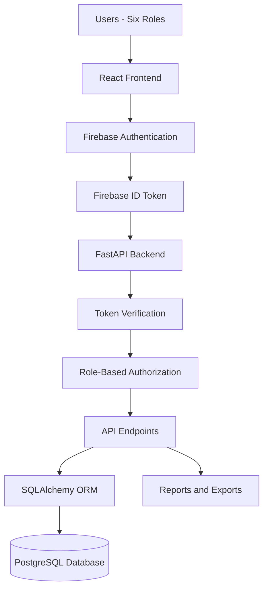

# SuvaiLedger ERP– Integrated Snack Manufacturing, Inventory & Order-to-Audit Management System

**A role-based ERP platform for managing snack manufacturing operations, inventory, sales, dispatch, payments and audit tracking through a centralized system.**

🌐 **Live Application:** https://order-to-audit-snack-system.vercel.app/

---

## 1. Project Overview

SuvaiLedger ERP is a web-based Enterprise Resource Planning (ERP) application designed to streamline and integrate the day-to-day operations of a snack manufacturing business.

Traditional manufacturing workflows often involve disconnected processes for purchasing raw materials, production planning, inventory tracking, order management, dispatch and financial records. This can lead to data inconsistencies, limited visibility and difficulties in tracking operational activities.

SuvaiLedger ERP addresses these challenges by providing a centralized platform where different departments can access and manage their respective operations through role-based authentication and permissions.

The system connects operational data across the manufacturing and sales lifecycle, providing improved visibility, traceability and accountability.

## 2. Key Features

- **Role-Based Access Control:** Separate access permissions for six user roles.
- **Purchase Management:** Record and manage raw material purchases.
- **Production Management:** Manage production runs using Bill of Materials (BOM).
- **Inventory Management:** Track stock movements through a centralized stock ledger.
- **Order Management:** Create and monitor customer orders.
- **Dispatch Approval:** Support controlled order dispatch approval.
- **Payment Management:** Record and track customer payments.
- **Audit & Reporting:** View audit summaries and operational records.
- **Data Export:** Generate PDF and spreadsheet-based reports.
- **Benchmark Reset:** Controlled benchmark-data reset functionality for administrative use.

## 3. User Roles

The application supports six operational roles:

| Role       | Responsibilities                                                                       |
| ---------- | -------------------------------------------------------------------------------------- |
| Admin      | Purchase management, order monitoring, dispatch approval and administrative operations |
| Owner      | Business oversight, purchases, order approval, payments and audit visibility           |
| Production | Production operations and stock ledger access                                          |
| Auditor    | Access to audit summaries, orders, master data and stock records                       |
| Salesman A | Sales and customer order operations                                                    |
| Salesman B | Sales and customer order operations                                                    |

Access to backend operations is controlled through authenticated user identities and role-based authorization.

## 4. Functional Modules

### Purchase Management

- Record raw material purchases.
- Maintain purchase-related operational data.
- Support inventory input tracking.

### Production Management

- Manage production runs.
- Use Bill of Materials (BOM) information.
- Record production-related stock movements.

### Inventory & Stock Ledger

- Maintain stock movement records.
- Track inventory changes.
- Provide stock visibility for authorized roles.

### Order Management

- Create customer orders.
- Retrieve and monitor order information.
- Support order processing and dispatch approval.

### Dispatch & Payments

- Provide an approval workflow for dispatch.
- Record customer payment transactions.
- Maintain payment-related records.

### Audit & Reporting

- Provide audit summary information.
- Support operational monitoring.
- Generate downloadable PDF and spreadsheet reports.

## 5. Technology Stack

| Layer                        | Technologies                  |
| ---------------------------- | ----------------------------- |
| Frontend                     | React 19, Vite                |
| Styling                      | Tailwind CSS                  |
| Backend                      | Python, FastAPI               |
| Database ORM                 | SQLAlchemy                    |
| Production Database          | PostgreSQL                    |
| Local Development Database   | SQLite                        |
| Authentication               | Firebase Authentication       |
| Firebase Backend Integration | Firebase Admin SDK            |
| PDF Generation               | jsPDF, jsPDF-AutoTable, FPDF2 |
| Spreadsheet Processing       | XLSX, OpenPyXL                |
| Frontend Hosting             | Vercel                        |
| Backend Hosting              | Render                        |

## 6. System Architecture

SuvaiLedger ERP follows a frontend-backend architecture with centralized database management and Firebase-based authentication.



### Architecture Components

- **Frontend:** Provides the user interface for different operational roles.
- **Firebase Authentication:** Authenticates users and provides Firebase ID tokens.
- **FastAPI Backend:** Handles API requests, business operations and authorization.
- **Firebase Admin SDK:** Verifies Firebase ID tokens on the backend.
- **SQLAlchemy:** Handles database interactions through ORM models.
- **PostgreSQL:** Stores production application data.
- **SQLite:** Supports local development.

## 7. Database Models

The backend uses SQLAlchemy models to represent the application's core entities.

| Model         | Purpose                                 |
| ------------- | --------------------------------------- |
| User          | User accounts and role information      |
| Customer      | Customer records                        |
| Item          | Raw materials and product information   |
| BOM           | Bill of Materials                       |
| StockLedger   | Inventory movement records              |
| ProductionRun | Production activity records             |
| Order         | Customer order information              |
| OrderItem     | Individual items associated with orders |
| Payment       | Payment transaction records             |

## 8. Backend API Overview

The FastAPI backend exposes the following API endpoints:

| Method | Endpoint                                  | Purpose                             |
| ------ | ----------------------------------------- | ----------------------------------- |
| GET    | `/api/auth/me`                            | Retrieve authenticated user details |
| POST   | `/api/login`                              | Legacy login endpoint               |
| GET    | `/api/master-data`                        | Retrieve master data                |
| POST   | `/api/purchases`                          | Create purchase records             |
| POST   | `/api/production`                         | Record production                   |
| POST   | `/api/orders`                             | Create customer orders              |
| GET    | `/api/orders`                             | Retrieve orders                     |
| POST   | `/api/orders/{order_id}/approve-dispatch` | Approve order dispatch              |
| POST   | `/api/payments`                           | Record payments                     |
| GET    | `/api/ledger`                             | Retrieve stock ledger               |
| POST   | `/api/reset-benchmark`                    | Reset benchmark data                |
| GET    | `/api/audit-summary`                      | Retrieve audit summary              |

API documentation is available through FastAPI Swagger UI at:

`https://YOUR-https://snack-erp-backend.onrender.com/docs-URL/docs`

## 9. Project Structure

```text
snack-erp/
│
├── backend/
│   ├── database.py
│   ├── firebase_auth.py
│   ├── link_firebase_users.py
│   ├── main.py
│   ├── models.py
│   ├── security.py
│   ├── seed.py
│   └── requirements.txt
│
├── frontend/
│   ├── public/
│   ├── src/
│   │   ├── assets/
│   │   ├── App.css
│   │   ├── App.jsx
│   │   ├── firebase.js
│   │   ├── index.css
│   │   └── main.jsx
│   ├── package.json
│   └── vite.config.js
│
├── .gitignore
└── README.md
```

## 10. Installation & Local Setup

### Prerequisites

- Python 3.10 or later
- Node.js and npm
- Git
- Firebase project with Authentication enabled

### Step 1: Clone the Repository

```bash
git clone https://github.com/shobikas-2025cse/order-to-audit-snack_system.git snack-erp
cd snack-erp
```

### Step 2: Configure the Backend

```bash
cd backend
python -m venv venv
```

Activate the virtual environment.

**Windows:**

```powershell
.\venv\Scripts\Activate.ps1
```

Install dependencies:

```bash
pip install -r requirements.txt
```

Create a `.env` file in the backend directory:

```env
DATABASE_URL=sqlite:///./snack_factory.db
AUTH_SECRET=your_secure_secret_of_at_least_32_characters
FIREBASE_SERVICE_ACCOUNT_PATH=firebase-service-account.json
ENABLE_BENCHMARK_RESET=false
```

Configure the Firebase Admin SDK service account file securely in the backend directory.

Start the backend:

```bash
uvicorn main:app --reload --port 8001
```

Backend API:

`http://127.0.0.1:8001`

Swagger documentation:

`http://127.0.0.1:8001/docs`

### Step 3: Configure the Frontend

Open another terminal:

```bash
cd frontend
npm install
```

Create a `.env.local` file in the frontend directory:

```env
VITE_API_URL=http://127.0.0.1:8001/api
VITE_FIREBASE_API_KEY=your_firebase_api_key
VITE_FIREBASE_AUTH_DOMAIN=your_firebase_auth_domain
VITE_FIREBASE_PROJECT_ID=your_firebase_project_id
VITE_FIREBASE_STORAGE_BUCKET=your_firebase_storage_bucket
VITE_FIREBASE_MESSAGING_SENDER_ID=your_sender_id
VITE_FIREBASE_APP_ID=your_firebase_app_id
```

Replace the Firebase configuration placeholders with the values from your Firebase project.

Start the frontend:

```bash
npm run dev
```

The frontend will be available at the local Vite development URL, usually:

`http://localhost:5173`

## 11. Deployment

SuvaiLedger ERP is deployed using separate frontend and backend hosting services.

| Component           | Platform          |
| ------------------- | ----------------- |
| Frontend            | Vercel            |
| Backend             | Render            |
| Production Database | Render PostgreSQL |
| Authentication      | Firebase          |

**Live Application:**

https://order-to-audit-snack-system.vercel.app/

The production frontend communicates with the deployed FastAPI backend through its configured API URL.

Production environment variables and Firebase service account credentials must be configured through the hosting providers' environment and secret-file settings.

## 12. Security

- Firebase Authentication for user authentication.
- Firebase ID token verification on the backend.
- Role-based authorization for protected API endpoints.
- Environment variables for configuration and sensitive values.
- Private Firebase Admin service account credentials.
- Git ignore rules to prevent local environment files and database files from being committed.

**Important:** Never commit `.env` files, Firebase service account JSON files, database credentials or private secrets to the public repository.

## 13. Future Enhancements

Potential areas for future development include:

- Advanced inventory analytics and forecasting.
- Production planning and demand prediction.
- Automated low-stock alerts.
- Enhanced financial dashboards.
- Detailed operational analytics.
- Improved reporting and business intelligence.

## 14. Project Information

**Project Name:** SuvaiLedger ERP

**Category:** Enterprise Resource Planning (ERP)

**Domain:** Manufacturing, Inventory and Business Process Management

**Deployment:** Vercel + Render

**Status:** Deployed and operational

---

_SuvaiLedger ERP – Connecting purchasing, production, inventory, sales and auditing through one integrated platform._
